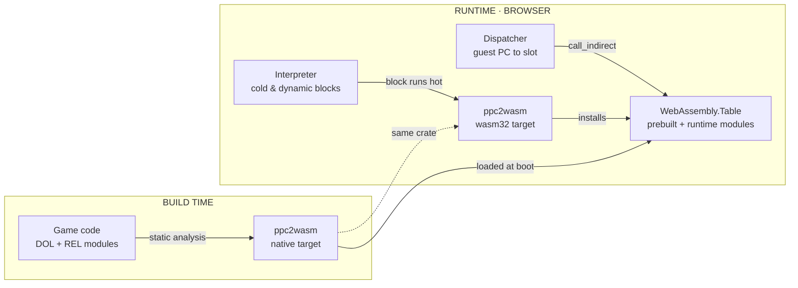
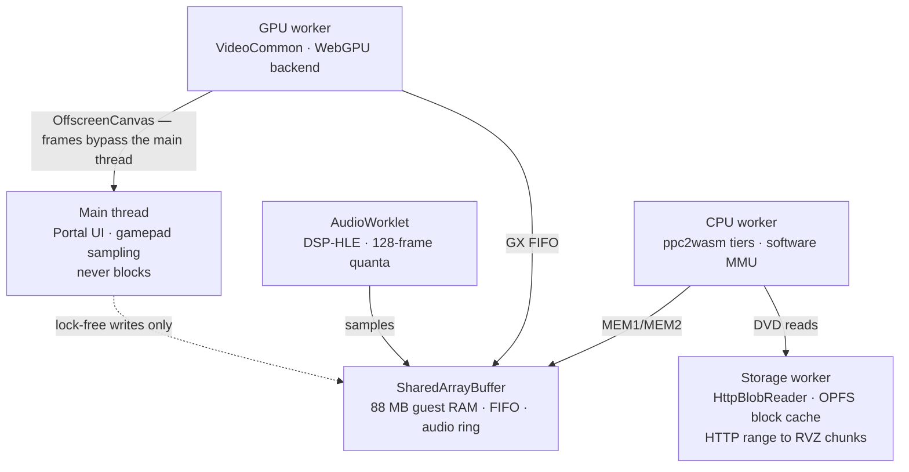

# Skylanders on WebAssembly

**Engineering plan · v1**

Run *Skylanders: Spyro's Adventure* entirely client-side in a browser, with all 530 figures
available through an emulated Portal of Power. **No streaming, no server-side emulation.**

| | |
|---|---|
| **Target** | Chrome / Edge desktop first |
| **Estimate** | 12–18 months |
| **Baseline** | `dolphin-emu/dolphin` @ 2609a |
| **Go/no-go** | Phase 0 complete — **proceed** |
| **Measured** | Spike A 863.9 MIPS · Spike C 16.670 ms p99 · Spike B partial |

---

## 1. Feasibility audit

Five assumptions this plan rests on. All five were checked against the source, not recalled.

| Assumption | Status | Evidence in tree |
|---|---|---|
| Portal of Power is already emulated | **Confirmed** | `Core/IOS/USB/Emulated/Skylanders/` — 530 figure variants, MIFARE 1K crypto implemented in `SkylanderCrypto.cpp` |
| Renderer survives without geometry shaders | **Confirmed** | `bSupportsGeometryShaders=false` is a first-class path with fallbacks throughout `VideoCommon`; the Metal backend ships on it |
| A new GPU backend is bounded work | **Confirmed** | Metal backend is **4,618 LOC** — smallest of five, and the closest architectural match to WebGPU |
| Can run without a reserved virtual arena | **Confirmed** | `MAIN_FASTMEM`, `MAIN_PAGE_TABLE_FASTMEM` and `MAIN_FASTMEM_ARENA` are independent toggles |
| Disc can be streamed rather than downloaded | **Confirmed** | `DiscIO::BlobReader` is abstract — `Read(offset,size,ptr)` plus `GetBlockSize()`; RVZ is chunk-indexed |

The fourth row was the one that could have ended the project. Dolphin's fast memory path depends
on reserving a multi-gigabyte virtual address range and catching faults with a signal handler —
neither exists in WebAssembly. That it is already an independent, disableable toggle means the
software MMU path is supported upstream rather than something we'd have to invent.

> **The Skylanders half of this project is already finished.**
>
> Dolphin emulates the USB portal device itself and ships a database of 530 figure variants across
> all five games — 251 Skylanders, 61 Swappers, 60 Traps, 40 Vehicles, 16 Giants, 28 Minis and more —
> generating valid NFC dumps on demand.
>
> That code lives in `Core/IOS/USB/Emulated/`, is plain platform-independent C++, and has no
> dependency on Qt, on the host USB stack, or on anything that does not survive an Emscripten build.
> It ports for free. **Every engineering hour goes to the browser problem.**

---

## 2. The CPU problem

> WebAssembly cannot write executable memory. That single fact dictates the whole execution model.

Dolphin has exactly two recompilers — `Jit64` for x86-64 and `JitArm64` for AArch64 — and both work
by writing instructions into a mapped executable buffer and jumping into it. In WebAssembly there is
no such buffer. The only route to new code is compiling and instantiating a whole new module, which
costs on the order of a millisecond and cannot be done per basic block.

The naive reading is that we fall back to the interpreter and the project dies there. It doesn't,
for one reason: **we are not building a Wii emulator, we are building a runtime for one known game.**
Skylanders' executable code ships on the disc as a `DOL` plus a set of `REL` modules. Most of it can
be found, decoded and translated *before the browser ever runs*.



**One compiler, two targets, three execution tiers.** The same Rust crate is compiled natively to
translate the game's static code ahead of time, and compiled to `wasm32` to translate hot blocks the
interpreter discovers at runtime — dynamically loaded RELs, overlays, anything static analysis
missed. Both emit into one function table, so the dispatcher never needs to know which tier produced
a block.

### Speed — measured, not assumed

This section originally assumed WebAssembly would cost **2–4× against the AArch64 recompiler** and
derived a 75–250% speed range from it. **Spike A measured it instead, and that assumption was
wrong in our favour.**

600-ish lines of recompiler-shaped Rust, built natively and as `wasm32`, 30M iterations × 11 trials
on an M4 (`spikes/jit/`):

| Variant | Native aarch64 | Chrome 155 | ratio |
|---|---|---|---|
| inlined, bounds-checked | 842.9 MIPS | 722.8 | 0.86 |
| inlined, masked + lazy CR | 844.2 MIPS | 609.3 | 0.72 |
| **state in memory, `call_indirect`** | **596.9 MIPS** | **863.9** | **1.45** |

The third row is the one that predicts the emulator — guest state in memory, blocks reached through
a runtime-populated indirect table. **WebAssembly beat native by 1.45× on it**, and its slowest
trial (793 MIPS) still clears the 600 MIPS gate.

Why WASM wins there is not established. Two plausible contributors, neither verified: V8's
`call_indirect` against a bounded table may be cheaper than a native load-from-global plus
unpredictable indirect branch, and eight small block functions may give V8's register allocator an
easier problem than one large loop.

**This is a ceiling, not a prediction.** The kernel is synthetic, with eight blocks of one shape and
unrealistically good icache behaviour. Real code has thousands of varied blocks. If diversity and
icache pressure cost 2×, this lands near 430 MIPS and the gate becomes marginal again.

### Floating point must not contract

Spike A surfaced a requirement the plan did not have. The `naive` and `tuned` variants produce
identical checksums on both targets; the dispatch variant does not — native `8641789f` vs Chrome
`27617d8c`. They agree at 10 iterations and diverge by 10M, which is rounding, not logic.

aarch64 contracts `a*c + b*d` into a fused multiply-add with one rounding step. WebAssembly has no
scalar FMA instruction and rounds twice.

Broadway's paired-single operations have defined rounding behaviour, so **`ppc2wasm` must control
contraction explicitly**, and **the differential harness must compare floats bit-exactly**. A
harness built with tolerant float comparison will not catch this class of bug at all.

---

## 3. Browser runtime

> Four threads, one shared buffer, and a main thread that is never allowed to block.

Dolphin is already multithreaded — CPU, GPU, audio and a shader compiler pool. Mapping that onto the
browser means Emscripten pthreads over `SharedArrayBuffer`, which requires serving the page with
`Cross-Origin-Opener-Policy: same-origin` and `Cross-Origin-Embedder-Policy: require-corp`.

The constraint that shapes the topology: **`Atomics.wait` throws on the main thread.** Every thread
that blocks on a synchronisation primitive must therefore be a worker, and the main thread is left
with input sampling and the Portal UI. Spike C verified this directly rather than assuming it.

**Spike C measured the whole topology** (`spikes/threading/`): three CPU workers blocking on
`Atomics.wait` and burning 3 ms each, a GPU worker owning the canvas via `transferControlToOffscreen`,
an AudioWorklet pulling from a lock-free shared-memory ring, and a main thread that never blocks.
600 frames at 60 Hz in Chrome 155:

| | |
|---|---|
| interval mean | 16.667 ms (target 16.667) |
| p50 / p95 / p99 | 16.665 / 16.670 / **16.670** ms |
| dropped frames | **0** |
| audio underruns | **0** |
| GPU frame signals observed | **600 / 600** |

Three microseconds of jitter at p99. The browser's primitives are good enough.

That is **not** the same as the emulator pacing well: these threads never wait on each other, while
real emulation has the CPU thread feeding the GX FIFO and the DSP consuming on a deadline, where a
stall anywhere propagates.



**The main thread is a spectator.** Because `Atomics.wait` is illegal there, CPU, GPU and audio all
run as workers that block on the shared buffer, while the main thread only writes input lock-free
and hands its canvas to the GPU worker through `transferControlToOffscreen`. Rendered frames never
pass through it, so Portal UI work cannot cause a dropped frame.

### The disc never gets downloaded

Your RVZ is 3.8 GB, which is not a browser asset. It doesn't need to be. RVZ is chunk-indexed,
`BlobReader` is already an abstract block interface, and a game touches only a fraction of its own
disc. A subclass issuing HTTP range requests against the chunk index, backed by an OPFS cache
through `createSyncAccessHandle()`, is roughly 300 lines and turns a 3.8 GB download into a few
hundred megabytes fetched lazily and kept across sessions.

Worth testing early and cheaply: that file is suspiciously large for RVZ. Re-converting it with
`DolphinTool` at zstd level 22 with junk-data scrubbing could plausibly cut it by more than half
before any of this matters.

### 3a. What the game actually asks of the GPU

Scope measured from two captures, both decoded 100% (`harness/src/fifo_inventory.py`). The second
required driving the game into the first level headlessly — Spyro on the emulated portal, a Nunchuk
attached, scripted input through Dolphin's Pipes device (`scripts/record-gameplay.sh`).

| | Title screen | Gameplay |
|---|---|---|
| Command volume | 57,628 B | **114,436 B** |
| BP writes / distinct regs | 1732 / 97 | 2741 / **63** |
| TEV stages | 1, 2, **9** | **1, 2** |
| texgens | 1, 2 | **1** |
| Blend dst factors | inv_src_alpha, one | + **dst_alpha** |
| **Logic ops** | none | **none** |
| Texture formats | 1, 3, 6, 14 | identical |
| Primitives | 229 fan, 9 strip | 183 fan, 24 strip |

Three things follow:

1. **Logic ops are unused.** They would require reading the destination colour in the fragment
   shader, which WebGPU cannot do — no framebuffer fetch, no programmable blending. Supporting them
   means a readback per draw or full subpass emulation. Not needed.
2. **Gameplay is narrower than the title screen**, not wider. Twice the command volume through
   fewer registers, fewer texgens and simpler vertex formats. The title screen is the more demanding
   frame. This retires the main scoping risk, though it is still one moment in the first level.
3. **WebGPU has no triangle-fan topology** and fans are the hot path. Expansion to triangle lists
   belongs in the vertex loader, not per draw.

Confirmed present on a real Chrome 155 adapter (`spikes/webgpu/`), which reports **apple / metal-3**:
`texture-compression-bc` (CMPR uploads as BC1 with no CPU decode), `dual-source-blending` (the
dst-alpha pass in one pass), `float32-filterable`. The adapter being Metal is direct support for
Bet 03.

---

## 4. Architectural bets

Five decisions that are expensive to reverse. Each is a bet, not a certainty.

### Bet 01 · Compiler — Recompile ahead of time, interpret the remainder

Translate the game's `DOL` and `REL` code to WebAssembly at build time; fall back to an interpreter
for anything static analysis cannot reach, and promote hot blocks with a runtime tier.

> Because targeting one game is the only thing that makes the WebAssembly code-generation limit
> survivable. A general emulator must JIT; a single-title runtime can do most of its work offline,
> where a millisecond of compile time is free.

### Bet 02 · Language — Rust for the recompiler, C++ for the emulator

Port Dolphin's C++ through Emscripten unchanged. Write `ppc2wasm` — the Broadway-to-WebAssembly
translator, including the paired-single instructions — as a new Rust crate on `wasm-encoder`,
compiled both natively and to `wasm32`.

> Because Rust is the right tool for the part that is genuinely new, and the wrong tool for the part
> that is twenty years of accumulated per-game hardware fixes. Rewriting Dolphin in Rust throws away
> the only asset that makes this game run correctly.

### Bet 03 · Graphics — Model the WebGPU backend on Metal, not OpenGL

Fork `VideoBackends/Metal` rather than `OGL`. Both are explicit, command-buffer APIs with no
geometry shaders and no framebuffer fetch, and Metal is the smallest backend in the tree at 4,618
lines.

> Because the Metal backend is live proof that Dolphin's renderer already works within exactly the
> constraints WebGPU imposes. The OpenGL backend would hand us a pile of GL-specific feature paths
> that WebGPU cannot honour.

### Bet 04 · Correctness — Native Dolphin is the test oracle

Instrument a native build to capture traces from the real game — CPU state at block boundaries, GX
FIFO command streams, DSP output, IOS calls — and replay them against the browser build, diffing
automatically in CI.

> Because "the game looks wrong" is an unactionable bug report in an emulator, and we will produce
> thousands of them. A differential harness converts every one into a specific diverging
> instruction. This is the decision that most determines whether the project finishes.

### Bet 05 · Delivery — Stream the disc, cache in OPFS

Serve the RVZ from object storage with range requests against its chunk index. Cache decompressed
blocks in OPFS. Saves go to the same place.

> Because the alternative is asking a browser to hold 3.8 GB before the first frame, and because the
> chunk index that makes this work already exists in the file format.

---

## 5. Roadmap

Phase 0 is a decision, not a deliverable. Everything after it is conditional on passing.

### Phase 0 — COMPLETE · decision: proceed

| Spike | Gate | Outcome |
|---|---|---|
| **A — throughput** | ≥ 600 MIPS | **MET — 863.9 MIPS** in Chrome (slowest trial 793) |
| **B — graphics** | render one frame correctly | **capability confirmed; render gate not met** |
| **C — threading** | hold 16.67 ms pacing | **MET — 16.670 ms p99, 0 drops, 0 underruns** |

Spike B is the one carried forward. Every WebGPU capability the game needs is confirmed present in
real Chrome, and 100% of a captured frame decodes, but no renderer exists yet — XF matrices, texture
decode and TEV→WGSL are Phase 3 work rather than spike work. Nothing it found disqualifies the
approach.

**What Phase 0 changed in this plan:** the 2–4× WASM penalty assumption is gone (§2), float
contraction became a hard requirement (§2), and the GX scope is now measured rather than guessed
(§3a).
### Phase 1 — Dolphin core under Emscripten, headless · ~2 months

Get `Core` and `PowerPC` compiling to `wasm32` with the Null video backend, no audio, no UI. Replace
the memory arena with the software MMU path, stub the host USB stack, and bring up the
`HttpBlobReader`.

- The game's boot sequence executes under the interpreter — **done**
- CPU state matches a captured native trace instruction for instruction — **done**, 20,000 steps
  byte-identical between `wasm32` in Chrome and the native oracle
- Differential harness running in CI from day one — **partly**. `ci.yml` gates every push on the GX
  decoder tests, repo hygiene and commit format (~10s). `nightly.yml` builds Dolphin and runs
  `coreboot` and `tracetest`, which need no disc — written but **not yet verified on a runner**.
  Everything that touches the real disc (boot differential, FIFO milestone, capture comparison)
  is still manual, and cannot move to a hosted runner: the disc is 4.7 GB and copyrighted

> **Gate** — Boot to the first rendered frame's FIFO write, verified against the oracle. Speed is
> irrelevant here; correctness is the whole deliverable.
>
> **Status: met.** `harness/wasm-core/run-fifo.sh` boots `SSPE52` from the real disc on both targets
> and reaches the first graphics FIFO write at the *same instruction*:
>
> ```
> MATCH -- both targets reach the first FIFO write identically
>   fifo cfg  step 63034350, pc 0x80370150, base=0x0000d780 end=0x0000d760
>   fifo wr   step 63034359, pc 0x80370174, wp=0x0000d780 (was 0x00000000)
> ```
>
> 63 million instructions of real game boot, landing on the same step index, the same PC and the
> same Command Processor state. `run-boot.sh` separately compares a full instruction trace over the
> first 20,000 steps (`MATCH -- 20000 steps identical`).

**Both targets now run identically for billions of instructions.** With synthetic input driving the
game past its attract loop, at a fixed 5 billion instructions:

```
MATCH -- gx-native and gx-wasm are byte-identical (1167944 bytes)
724 draws, 33,258 vertices, 821 EFB copies
```

CPU state matches at every checkpoint to 3 billion instructions, and the GX command stream — what
the emulator actually sends to the GPU — is byte-identical. That is the strongest statement this
project can currently make: the browser build is not approximately right, it is *the same*.

### Four divergences, and what they were actually about

| # | found at | cause | class |
|---|---|---|---|
| 1 | 64M | VI clock from uninitialised region: `HW::Init` ran before `SetPathsAndGameMetadata` | ordering |
| 2 | 477M | `Wiimote::Initialize` skipped on one target "as a precaution" | one-sided config |
| 3 | 531M | host network state reaching the oracle through `/dev/net/ip/top` | one-sided config |
| 4 | — | a flag passed to native but not the browser (literal `$f` from a heredoc) | one-sided config |

**Not one of them was an emulation bug.** Every single one was the harness configuring its two
targets differently, or reading state before something set it. The recompiler, the float
contraction, the memory arena — none of the things the plan worried about — produced a single
divergence. What did was *the harness itself*.

Three lessons that generalise past this project:

1. **A reference that depends on its environment is not a reference.** Native read host network
   state, so it would not reproduce against itself on a different network. That makes every
   comparison built on it unfalsifiable, which is worse than a comparison that fails.
2. **Being right by luck is more dangerous than being wrong.** Native read an uninitialised region
   as `NTSC_J` — the wrong region for a USA disc — and still produced correct VI timing, because the
   only thing consulted was `IsNTSC()`. A harness that only ran natively would never have found it.
3. **A precaution applied to one target is a divergence by construction.** Skipping Wiimote init
   "just in case" cost a bug that surfaced 477 million instructions away, and the fourth divergence
   was introduced *in the same commit as the comment warning about it*.

**What finding them required** was instrumentation at four layers, because a CPU-state differential
stops being informative the moment the guest reads a device register. Weak hooks now report
CoreTiming dispatches, PI interrupt asserts, VI scanline state, IOS replies with device names, and
the GX command stream. Each one ruled out a layer so the next became meaningful.

**The first real wasm divergence, and it was the region bug again.** At step 64,452,098 native had
taken an external interrupt and wasm had not, with **identical GPRs**. Not a computation bug: the
guest state matched exactly and a scheduled interrupt arrived at a different time.

Localising it took four instrumentation hooks, each ruling out a layer:

| hook | question | answer |
|---|---|---|
| CoreTiming event dispatch | do events fire at different ticks? | **no** — identical ticks *and* steps |
| PI interrupt assert | is the interrupt raised differently? | **yes** — native `set=1`, wasm `set=0` |
| VI scanline state | why? | wasm was **one half-line behind**: hl 524 vs 525 |
| ticks-at-boot | from when? | from the **first VI event**: 11583 vs 23166 |

`GetTicksPerSample()` is `2 * TicksPerSecond / CLOCK_FREQUENCIES[m_clock & 1]`, and
`VideoInterface.cpp:162` sets `m_clock = IsNTSC(region)` — 27MHz or 54MHz. **`VideoInterface::Init`
runs inside `HW::Init`**, which the harness called *before* `SetPathsAndGameMetadata`. So VI read an
uninitialised `SConfig::m_region`: native got zeroed memory (`NTSC_J` — still NTSC, so the clock was
right **by luck**), wasm got reused heap and ran VI at **half rate**. One half-line of drift, and 64
million instructions later a vertical-retrace interrupt fired on one target and not the other.

Fixed by opening the disc and setting metadata before `HW::Init`, which is what
`BootManager::BootCore` does (`BootManager.cpp:56`, long before `Core::Init` reaches `HW::Init`).
After the fix the first divergence moves from **64M to 470M instructions**.

**The lesson is the ordering, not the register.** This is the *second* bug from the same
uninitialised `m_region`, found at a different consumer, long after the first was "fixed" — because
the fix set it early enough for `CBoot::BootUp` and not early enough for `HW::Init`. Anything the
harness initialises in a different order from `BootManager::BootCore` is a latent version of this,
and a divergence 64 million instructions deep is the cheap outcome; being right by luck on one
target is the expensive one.

**The draws are not in the FIFO.** The game emits `GX_CMD_CALL_DL` and the drawing commands live in
guest memory, not in the command stream. A 256 KB live capture contains 400 display lists and
**zero draws**. Dolphin's own recorder expands display lists inline before writing a `.dff`
(`OpcodeDecoding.cpp:234` skips recording the `CALL_DL` opcode itself), which is why
`harness/traces/*.dff` shows 238 real draws and a live capture shows none. **Following display
lists into guest memory is the next piece of work** — until then the live path sees register state
and nothing drawn.

This was found by a decoder bug, not despite one: `CALL_DL` consumes nine bytes (opcode + u32
address + u32 size) and the decoder skipped one, walking into the address field and reading it as
opcodes. It invented a 34,583-vertex tri-strip out of a pointer — more geometry than the entire
title screen's 3,667 vertices. **100% decode coverage was reported throughout**, because coverage
measures whether the walker consumed the bytes, not whether it understood them. The lesson
generalises past this decoder: *a metric that cannot distinguish comprehension from consumption is
not a correctness check.*

**The FIFO decodes.** `harness/src/decode_capture.py` decodes a GX command stream captured live out
of `Core/HW/GPFifo.cpp`'s gather-pipe flush (patch 0008), rather than from a `.dff` recording. A
256 KB capture from a native boot decodes at **100% coverage**: 76 CP / 557 BP / 89 XF register
writes, 4 EFB copies, and a `pos,tex0` tri-strip. Reaching it took 4.0 billion instructions
(~5.5 s emulated) and 454 disc requests / 13.16 MB.

**Three bugs, all the same shape: the harness calls `CBoot::BootUp` directly and skips
`BootManager::BootCore`.** Each one established global state that something much later depended on,
and each failed a long way from its cause:

| missing call | where | how it failed |
|---|---|---|
| `SetPathsAndGameMetadata` | `BootManager.cpp:56` | `SConfig::m_region` left uninitialised; wrong video standard read back **59.7 M instructions** later |
| `FifoManager::Prepare()` | `Core.cpp:656` | `m_syncing_suspended` defaults to **false**, so `RunGpu()` never schedules the GPU; the FIFO filled and the game spun at `0x803873a0` for **10 billion instructions** |
| `TransferSYSCONFControlToGuest()` | `BootManager.cpp:163` | a config save built a second `IOS::HLE::Kernel`, tripping `IOS.cpp:285` mid-run |

**This is a standing hazard, not three incidents.** Anything else `BootCore` sets up is still unset,
and the next one will also surface far from its cause. The harness should either move to
`BootManager::BootCore` or audit that function line by line — the current approach discovers these
one crash at a time.

**Determinism had to be bought, not assumed.** The first attempt at this comparison failed because
*native disagreed with itself*: the step index of the first FIFO write drifted by a few hundred
between runs. `SystemTimers.cpp:253` seeds the emulated clock from
`Common::Timer::GetLocalTimeSinceJan1970()`, so every run starts the guest at a different wall-clock
time. Invisible at 20,000 instructions, decisive at 63 million. The harness now pins
`MAIN_CUSTOM_RTC_ENABLE`/`MAIN_CUSTOM_RTC_VALUE`. **A differential harness has to control every
host-derived input, and wall-clock is one.**

**The first real divergence this found.** With both sides deterministic, wasm reached the FIFO 515
instructions after native — reproducibly. Localising it needed three passes, because a 63-million-step
trace is not transportable out of a browser: checkpoints every 100k steps narrowed it to a 100k
window, a traced window narrowed it to one step, and a register dump named the instruction.

The divergence was at `lwz r24, 204(r3)` — a *load*, with `r3 = 0x80000000`, so it reads the
low-memory global at `0x800000CC`. `Boot_BS2Emu.cpp:512` writes `IsNTSC(m_region) ? 0 : 1` there
("Fake the VI Init of the IPL"). `SConfig::m_region` is declared at `ConfigManager.h:53` **with no
initialiser**, and it is set by `SetPathsAndGameMetadata`, which only `BootManager::BootCore` calls —
a path the harness skipped by invoking `CBoot::BootUp` directly. So the region was *never set on
either target*: native read zeroed memory (`NTSC_J` — wrong for a USA disc, but still NTSC, so the
write came out right by luck) and wasm read reused heap and got `4606276`, which is not a `Region` at
all. The game read the wrong video standard back 59.7 million instructions later and branched
differently.

This is the bug class the differential exists to catch — **identical code, identical input, and a
divergence that exists only because one target's uninitialised memory happens to be zero.** It would
never have been found by testing either target alone, and it was invisible for the first 59 million
instructions.

**What the browser boot needed, and what it cost.** Three subsystems had to be configured away
before `HW::Init` would complete under Emscripten, all for one reason: a `pthread` created from the
proxied main thread is spawned *by* the browser main thread, so a creator that waits on the new
thread while that thread is mid-proxied-call deadlocks. The offender was
`ExpansionInterface::Init` — a configured memory card constructs a `MemoryCard`, whose constructor
starts a flush thread. DSP LLE and cubeb are the same hazard class and are disabled alongside it.
None of the three matters for this title in a browser (a Wii saves to NAND; audio will be an
AudioWorklet), so nothing was given up — but it means **init-time thread creation is a standing
constraint on this port**, not a one-off fix, and every subsystem brought up later has to be checked
against it.

**A measurement lesson worth keeping.** The stall was mis-localised to `AudioCommon::InitSoundStream`
for a full day because the evidence was `printf`, and under `PROXY_TO_PTHREAD` `printf` is proxied to
the browser main thread — the same thread the deadlock holds. The output channel wedged *before* the
code being diagnosed, so the last line printed named an innocent function two steps behind the real
one. The fix was to report progress through the wasm heap instead: pthreads makes it a
`SharedArrayBuffer`, so the page can read a marker the worker wrote without the stalled thread
cooperating. **When diagnosing a hang, the reporting channel must not share the resource being
contended** — that is the generalisable part, and it applies to every later bring-up here.

### Phase 2 — `ppc2wasm`, the recompiler · ~4–6 months

> **Status: the boot runs at 145% of real time** in Chrome — 2.0 emulated seconds in 1.4 s
> of wall clock — and the game plays: pressing A takes it from the title into the tutorial
> level with the character on screen, 390 emulated seconds in 444 s of wall clock (88%), and
> the gameplay window itself, a 3D scene at 60 frames per emulated second, at 70% of real
> time with the GPU on its own thread (59% single-core). CPU-side, with the Null video
> backend. A profile of the window puts the recompiled CPU at 44% of the emulation thread,
> VideoCommon's command processing and texture hashing at 42%, and the interpreter (the fused
> multiply-adds through the hatch) at 9%; the game's own CPU work in gameplay is about 360
> million instructions per emulated second.
>
> **The constraint was never code density.** A sampling profile put the dispatcher loop at
> 35% of the run and the compiled blocks at 25%, with a hot set of ten functions; the same
> emitted code for the hottest loop ran at 0.59 ns per instruction in isolation, not the 2.6
> the residual implied. What moved the number: Dolphin's slice-based timing model, idle-loop
> skipping, `mtmsr` staying in the chain, MEM2 and the long tail of integer forms, a tier-up
> threshold, the interpreter called in place for what is not translated, and turning off the
> speed throttle that was quietly capping measurements at 100%.
>
> Documents, in this order:
>
> 1. **[PHASE3-HANDOFF.md](PHASE3-HANDOFF.md)** — the plan from here: where the time goes
>    thread by thread, the measurement to take first, the ranked work with kill gates, the
>    landmines. Start here.
> 2. **[PHASE3-FINDINGS.md](PHASE3-FINDINGS.md)** — the evidence: the profiles, the
>    disagreement with the density plan, what was built and what each step measured.
> 3. **[PHASE2-PROFILE.md](PHASE2-PROFILE.md)** — the earlier budget at 195 MIPS and the
>    three negative results. Its ranking is superseded; its landmines are not.
> 4. **[PHASE3-DENSITY.md](PHASE3-DENSITY.md)** — the density plan. Not pursued, for the
>    reasons in the findings document; kept for its working rules.
> 5. **[PHASE2-HANDOFF.md](PHASE2-HANDOFF.md)** — written at 54 MIPS; its methodology and
>    landmine sections have not gone stale.

The longest and least certain phase. A full Broadway decoder including paired singles, lazy
condition-register evaluation to avoid emulating flags on every operation, static discovery of
function boundaries and indirect branch targets across the `DOL` and `REL`s, then WebAssembly
emission and the runtime promotion tier.

- `ppc2wasm` crate, native and `wasm32` builds from one source
- REA and Ghidra driving the static analysis pass over the game binaries
- Tier-up from interpreter to compiled block, transparent to the dispatcher

> **Gate** — Full speed with the Null backend: the game running at 100% with nothing drawn. If the
> CPU cannot keep up before graphics are added, it never will afterwards.

### Phase 3 — WebGPU backend · ~3 months

> **Plan: [PHASE3-WEBGPU.md](PHASE3-WEBGPU.md)** — the backend's shape, the shader and
> readback questions, and the order of work. Spike S1 (a WebGPU device on Dolphin's GPU
> thread, through JSPI) is done: `spikes/webgpu-thread/FINDINGS.md`.

A new backend beside Metal and Vulkan: command encoding, pipeline state, TEV shader generation
targeting WGSL, texture decode in compute shaders, and the EFB-to-RAM paths. Expect the accuracy
work to concentrate in blending, where WebGPU gives us less than any native API.

- `VideoBackends/WebGPU`, with Metal as the structural template
- FIFO-replay regression suite diffing frames against native output

> **Gate** — The game is visually indistinguishable from native Dolphin across a fixed set of
> captured scenes.

### Phase 4 — Audio, input, saves, and the Portal · ~2 months

DSP-HLE into an AudioWorklet over a lock-free ring. Emulated Wii Remote and Nunchuk mapped to
gamepad and keyboard. Saves to OPFS. And the part that makes this *Skylanders* rather than a Wii
emulator demo: a web Portal of Power driving the already-ported `SkylanderUSB` device, with all 530
figures searchable by element, game and type.

- Drag a figure onto the portal, watch it appear in-game
- Figure state — levels, gold, upgrades — persisted per slot

> **Gate** — Play the game start to finish, swapping figures freely.

### Phase 5 — Ship it · ~1 month

COOP/COEP headers, asset delivery, cold-start time, and widening past Chrome to Firefox and Safari
as their WebGPU and WebAssembly feature coverage allows.

> **Gate** — A stranger opens a URL and is playing inside sixty seconds.

---

## 6. Risk register

What actually kills this, ranked by how much it would cost us.

| Risk | Severity | Mitigation |
|---|---|---|
| Recompiled code misses the speed target | **Retired to High** | Spike A measured 863.9 MIPS against a 600 gate, with WASM *beating* native 1.45× on the realistic variant. Remaining risk is that the kernel is synthetic: real block diversity and icache pressure could cost 2×, landing near 430 and making the gate marginal again. |
| Condition-register and paired-single emulation cost more than modelled | **High** | Lazy flag evaluation, in `ppc2wasm` from the first commit. Spike A's lazy-CR variant showed no penalty against the eager one. |
| **Float contraction diverges from Broadway** | **Fatal → Medium** | Found in Spike A, then **narrowed in Phase 1**. Dolphin computes `ps_madd` in *double* (`NI_madd_msub`), and a float32 significand is 24 bits, so `a*c` is at most 48 bits — exact in double's 53. When `round(a*c) == a*c`, fused and unfused round exactly once and cannot differ; verified over 200,000 random float32 triples with zero disagreements. **The risk does not reach paired singles carrying legitimate float32 data.** It remains open for (a) PS registers holding values that are not float32-exact, and (b) `ppc2wasm`, which will compute in whatever precision it emits rather than inheriting Dolphin's doubles. The harness must still compare floats bit-exactly. |
| Self-modifying code or overlays defeat ahead-of-time analysis | High | The interpreter plus runtime tier exists precisely for this. Risk is to *speed*, not correctness — we find out in Phase 2 what share of execution stays interpreted. |
| WebGPU has no framebuffer fetch, hurting EFB blend accuracy | **Retired to Low** | Spike B found **no logic ops** in either capture, which is what would have forced a readback. Blend factors used are all natively supported. |
| GX scope is read as a ceiling rather than a floor | **High** | Both captures are from the first level. Boss fights, spell effects and later worlds are unmeasured. Capture more before any irreversible scoping decision. |
| OPFS quota or eviction loses the cached disc | Medium | Request persistent storage; degrade to re-fetching range requests on eviction rather than failing. |
| Safari and Firefox lag on WebGPU or threading features | Accepted | Chrome and Edge desktop first, explicitly. Others follow when they can. |
| Browser memory ceiling | **Cleared** | 88 MB of guest RAM plus caches and compiled code fits inside the `wasm32` 4 GB limit comfortably. `memory64` is not needed, which keeps the door open for Safari. |

---

## 7. Out of scope

Every one of these is a thing we could build and a reason the project would not finish.

| Not building | Why |
|---|---|
| A general Wii emulator | We implement what *Spyro's Adventure* touches, and assert loudly on everything else. |
| The other four Skylanders games | The portal database already covers them. Revisit once one game runs. |
| Dolphin's Qt interface | Replaced entirely by the web shell. No Qt reaches the browser build. |
| Netplay and savestates | Savestates in particular are a deep dependency on host memory layout. Not in v1. |
| Real Wii Remote or real portal hardware | WebHID could reach both eventually. It is not on the path to playing. |
| Upstreaming to Dolphin | Keep the fork rebaseable and the licence obligations clean, but do not design around acceptance. |

---

## 8. Now — Phase 1

Phase 0 is complete and the decision is to proceed. Phase 1 is getting Dolphin's core compiling to
`wasm32` under Emscripten, headless, with the differential harness running from day one.

1. **Build `Common` under Emscripten first.** The smallest library with the most host-specific code
   — threads, filesystem, CPU detection, memory arena. What breaks there defines the port surface
   for everything above it.
2. **Replace the memory arena.** `MAIN_FASTMEM_ARENA=false` is already supported upstream; confirm
   the software MMU path builds and runs without a reserved virtual region.
3. **Stub the host USB stack.** The emulated Skylander portal is platform-independent and must
   survive; libusb must not be reached.
4. **Bring up `HttpBlobReader`.** A `DiscIO::BlobReader` subclass issuing range requests against the
   RVZ chunk index, cached in OPFS.
5. **Differential harness in CI.** Native Dolphin as oracle, comparing floats **bit-exactly** —
   see §2 on contraction.

> **Gate** — the game's boot sequence executes under the interpreter and CPU state matches a
> captured native trace instruction for instruction. Speed is irrelevant here; correctness is the
> whole deliverable.

### Already built in Phase 0, reused here

- `scripts/build-oracle.sh` — stock native Dolphin, the test oracle
- `scripts/record-gameplay.sh` — drives the game into a level headlessly (portal + Nunchuk +
  scripted input) and verifies the capture is not a loading screen
- `harness/src/` — FIFO decoder, 100% stream coverage, indexed vertex array resolution
- `spikes/threading/serve.mjs` — the COOP/COEP configuration the app will need

---

*Verified against `dolphin-emu/dolphin` at version 2609a, October 2026. Line counts and configuration
flags cited here were read from that tree, not recalled. Dolphin is GPL-2.0-or-later; any fork
inherits those obligations.*
