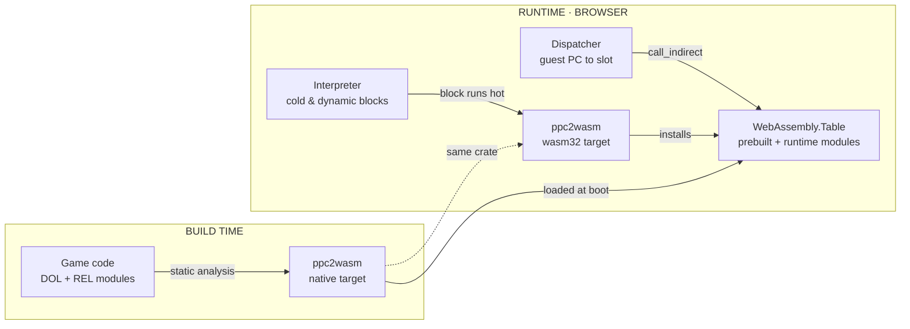
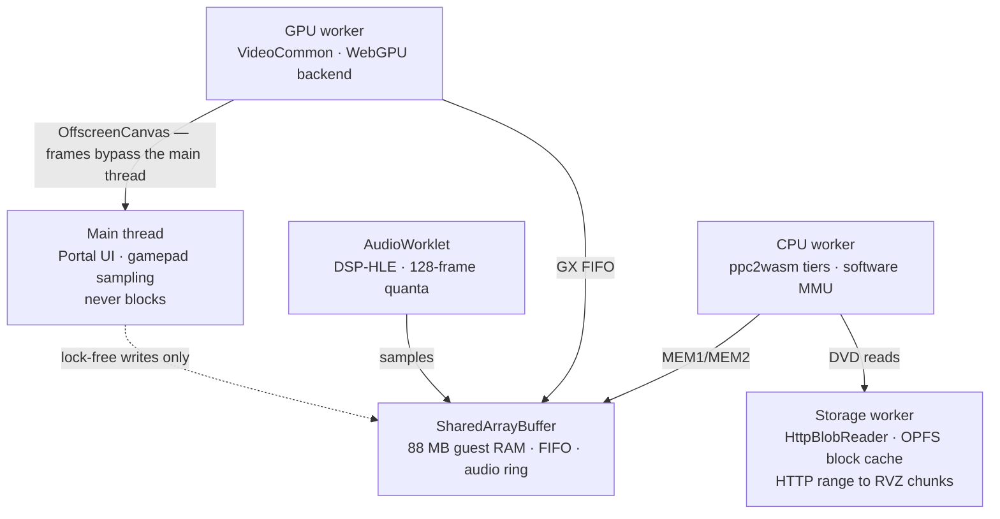

# Skylanders on WebAssembly

**Engineering plan · v1**

Run *Skylanders: Spyro's Adventure* entirely client-side in a browser, with all 530 figures
available through an emulated Portal of Power. **No streaming, no server-side emulation.**

| | |
|---|---|
| **Target** | Chrome / Edge desktop first |
| **Estimate** | 12–18 months |
| **Baseline** | `dolphin-emu/dolphin` @ 2609a |
| **Go/no-go** | End of Phase 0 |

---

## 1. Feasibility audit

Five assumptions this plan rests on. All five were checked against the source, not recalled.

| Assumption | Status | Evidence in tree |
|---|---|---|
| Portal of Power is already emulated | **Confirmed** | `Core/IOS/USB/Emulated/Skylanders/` — 530 figure variants, MIFARE 1K crypto implemented in `SkylanderCrypto.cpp` |
| Renderer survives without geometry shaders | **Confirmed** | `bSupportsGeometryShaders=false` is a first-class path with fallbacks throughout `VideoCommon`; the Metal backend ships on it |
| A new GPU backend is bounded work | **Confirmed** | Metal backend is **4,618 LOC** — smallest of five, and the closest architectural match to WebGPU |
| Can run without a reserved virtual arena | **Confirmed** | `MAIN_FASTMEM`, `MAIN_PAGE_TABLE_FASTMEM` and `MAIN_FASTMEM_ARENA` are independent toggles |
| Disc can be streamed rather than downloaded | **Confirmed** | `DiscIO::BlobReader` is abstract — `Read(offset,size,ptr)` plus `GetBlockSize()`; RVZ is chunk-indexed |

The fourth row was the one that could have ended the project. Dolphin's fast memory path depends
on reserving a multi-gigabyte virtual address range and catching faults with a signal handler —
neither exists in WebAssembly. That it is already an independent, disableable toggle means the
software MMU path is supported upstream rather than something we'd have to invent.

> **The Skylanders half of this project is already finished.**
>
> Dolphin emulates the USB portal device itself and ships a database of 530 figure variants across
> all five games — 251 Skylanders, 61 Swappers, 60 Traps, 40 Vehicles, 16 Giants, 28 Minis and more —
> generating valid NFC dumps on demand.
>
> That code lives in `Core/IOS/USB/Emulated/`, is plain platform-independent C++, and has no
> dependency on Qt, on the host USB stack, or on anything that does not survive an Emscripten build.
> It ports for free. **Every engineering hour goes to the browser problem.**

---

## 2. The CPU problem

> WebAssembly cannot write executable memory. That single fact dictates the whole execution model.

Dolphin has exactly two recompilers — `Jit64` for x86-64 and `JitArm64` for AArch64 — and both work
by writing instructions into a mapped executable buffer and jumping into it. In WebAssembly there is
no such buffer. The only route to new code is compiling and instantiating a whole new module, which
costs on the order of a millisecond and cannot be done per basic block.

The naive reading is that we fall back to the interpreter and the project dies there. It doesn't,
for one reason: **we are not building a Wii emulator, we are building a runtime for one known game.**
Skylanders' executable code ships on the disc as a `DOL` plus a set of `REL` modules. Most of it can
be found, decoded and translated *before the browser ever runs*.

**One compiler, two targets, three execution tiers.** The same Rust crate is compiled natively to
translate the game's static code ahead of time, and compiled to `wasm32` to translate hot blocks the
interpreter discovers at runtime — dynamically loaded RELs, overlays, anything static analysis
missed. Both emit into one function table, so the dispatcher never needs to know which tier produced
a block.

### Why this should land at playable speed

On an M4, native Dolphin runs *Spyro's Adventure* at several hundred percent of full speed.
WebAssembly typically costs between 1.2× and 2× against native C for compute-bound work, and our
translation gives up a few more things on top: no direct host register mapping, bounds-checked
memory on every guest load and store, and indirect calls at block boundaries. Call it **2–4× slower
than the AArch64 recompiler**.

Against a 300–500% starting margin, that lands between 75% and 250% of full speed. The bottom of
that range misses and the top clears comfortably — which is precisely why Phase 0 exists and why it
carries a hard numeric gate. We measure before we commit.

---

## 3. Browser runtime

> Four threads, one shared buffer, and a main thread that is never allowed to block.

Dolphin is already multithreaded — CPU, GPU, audio and a shader compiler pool. Mapping that onto the
browser means Emscripten pthreads over `SharedArrayBuffer`, which requires serving the page with
`Cross-Origin-Opener-Policy: same-origin` and `Cross-Origin-Embedder-Policy: require-corp`.

The constraint that shapes the topology: **`Atomics.wait` throws on the main thread.** Every thread
that blocks on a synchronisation primitive must therefore be a worker, and the main thread is left
with input sampling and the Portal UI.

**The main thread is a spectator.** Because `Atomics.wait` is illegal there, CPU, GPU and audio all
run as workers that block on the shared buffer, while the main thread only writes input lock-free
and hands its canvas to the GPU worker through `transferControlToOffscreen`. Rendered frames never
pass through it, so Portal UI work cannot cause a dropped frame.

### The disc never gets downloaded

Your RVZ is 3.8 GB, which is not a browser asset. It doesn't need to be. RVZ is chunk-indexed,
`BlobReader` is already an abstract block interface, and a game touches only a fraction of its own
disc. A subclass issuing HTTP range requests against the chunk index, backed by an OPFS cache
through `createSyncAccessHandle()`, is roughly 300 lines and turns a 3.8 GB download into a few
hundred megabytes fetched lazily and kept across sessions.

Worth testing early and cheaply: that file is suspiciously large for RVZ. Re-converting it with
`DolphinTool` at zstd level 22 with junk-data scrubbing could plausibly cut it by more than half
before any of this matters.

---

## 4. Architectural bets

Five decisions that are expensive to reverse. Each is a bet, not a certainty.

### Bet 01 · Compiler — Recompile ahead of time, interpret the remainder

Translate the game's `DOL` and `REL` code to WebAssembly at build time; fall back to an interpreter
for anything static analysis cannot reach, and promote hot blocks with a runtime tier.

> Because targeting one game is the only thing that makes the WebAssembly code-generation limit
> survivable. A general emulator must JIT; a single-title runtime can do most of its work offline,
> where a millisecond of compile time is free.

### Bet 02 · Language — Rust for the recompiler, C++ for the emulator

Port Dolphin's C++ through Emscripten unchanged. Write `ppc2wasm` — the Broadway-to-WebAssembly
translator, including the paired-single instructions — as a new Rust crate on `wasm-encoder`,
compiled both natively and to `wasm32`.

> Because Rust is the right tool for the part that is genuinely new, and the wrong tool for the part
> that is twenty years of accumulated per-game hardware fixes. Rewriting Dolphin in Rust throws away
> the only asset that makes this game run correctly.

### Bet 03 · Graphics — Model the WebGPU backend on Metal, not OpenGL

Fork `VideoBackends/Metal` rather than `OGL`. Both are explicit, command-buffer APIs with no
geometry shaders and no framebuffer fetch, and Metal is the smallest backend in the tree at 4,618
lines.

> Because the Metal backend is live proof that Dolphin's renderer already works within exactly the
> constraints WebGPU imposes. The OpenGL backend would hand us a pile of GL-specific feature paths
> that WebGPU cannot honour.

### Bet 04 · Correctness — Native Dolphin is the test oracle

Instrument a native build to capture traces from the real game — CPU state at block boundaries, GX
FIFO command streams, DSP output, IOS calls — and replay them against the browser build, diffing
automatically in CI.

> Because "the game looks wrong" is an unactionable bug report in an emulator, and we will produce
> thousands of them. A differential harness converts every one into a specific diverging
> instruction. This is the decision that most determines whether the project finishes.

### Bet 05 · Delivery — Stream the disc, cache in OPFS

Serve the RVZ from object storage with range requests against its chunk index. Cache decompressed
blocks in OPFS. Saves go to the same place.

> Because the alternative is asking a browser to hold 3.8 GB before the first frame, and because the
> chunk index that makes this work already exists in the file format.

---

## 5. Roadmap

Phase 0 is a decision, not a deliverable. Everything after it is conditional on passing.

### Phase 0 — Three spikes that decide whether to build this · ~4 weeks

Each spike answers one question with a number. Any spike that misses its gate stops the project
before the expensive part — that is the entire point of running them first.

- **Spike A — throughput.** Hand-translate a hot Skylanders function to WebAssembly and measure
  sustained guest instructions per second in Chrome against the native AArch64 recompiler.
- **Spike B — graphics.** Capture one real GX FIFO frame from the game, replay it through a minimal
  WebGPU renderer, confirm the TEV stages translate to WGSL and that blending gaps have workable
  fallbacks.
- **Spike C — threading.** Emscripten pthreads with three busy workers, an AudioWorklet and an
  OffscreenCanvas, holding 16.6 ms frame pacing.

> **Gate** — Spike A sustains **≥ 600 MIPS** guest throughput, roughly 100% of a 729 MHz Broadway
> with headroom. Spike B renders one frame correctly. Spike C holds pacing with no main-thread
> `Atomics.wait` violation. Miss any of the three and we stop, write up why, and revisit streaming.

### Phase 1 — Dolphin core under Emscripten, headless · ~2 months

Get `Core` and `PowerPC` compiling to `wasm32` with the Null video backend, no audio, no UI. Replace
the memory arena with the software MMU path, stub the host USB stack, and bring up the
`HttpBlobReader`.

- The game's boot sequence executes under the interpreter
- CPU state matches a captured native trace instruction for instruction
- Differential harness running in CI from day one

> **Gate** — Boot to the first rendered frame's FIFO write, verified against the oracle. Speed is
> irrelevant here; correctness is the whole deliverable.

### Phase 2 — `ppc2wasm`, the recompiler · ~4–6 months

The longest and least certain phase. A full Broadway decoder including paired singles, lazy
condition-register evaluation to avoid emulating flags on every operation, static discovery of
function boundaries and indirect branch targets across the `DOL` and `REL`s, then WebAssembly
emission and the runtime promotion tier.

- `ppc2wasm` crate, native and `wasm32` builds from one source
- REA and Ghidra driving the static analysis pass over the game binaries
- Tier-up from interpreter to compiled block, transparent to the dispatcher

> **Gate** — Full speed with the Null backend: the game running at 100% with nothing drawn. If the
> CPU cannot keep up before graphics are added, it never will afterwards.

### Phase 3 — WebGPU backend · ~3 months

A new backend beside Metal and Vulkan: command encoding, pipeline state, TEV shader generation
targeting WGSL, texture decode in compute shaders, and the EFB-to-RAM paths. Expect the accuracy
work to concentrate in blending, where WebGPU gives us less than any native API.

- `VideoBackends/WebGPU`, with Metal as the structural template
- FIFO-replay regression suite diffing frames against native output

> **Gate** — The game is visually indistinguishable from native Dolphin across a fixed set of
> captured scenes.

### Phase 4 — Audio, input, saves, and the Portal · ~2 months

DSP-HLE into an AudioWorklet over a lock-free ring. Emulated Wii Remote and Nunchuk mapped to
gamepad and keyboard. Saves to OPFS. And the part that makes this *Skylanders* rather than a Wii
emulator demo: a web Portal of Power driving the already-ported `SkylanderUSB` device, with all 530
figures searchable by element, game and type.

- Drag a figure onto the portal, watch it appear in-game
- Figure state — levels, gold, upgrades — persisted per slot

> **Gate** — Play the game start to finish, swapping figures freely.

### Phase 5 — Ship it · ~1 month

COOP/COEP headers, asset delivery, cold-start time, and widening past Chrome to Firefox and Safari
as their WebGPU and WebAssembly feature coverage allows.

> **Gate** — A stranger opens a URL and is playing inside sixty seconds.

---

## 6. Risk register

What actually kills this, ranked by how much it would cost us.

| Risk | Severity | Mitigation |
|---|---|---|
| Recompiled code misses the speed target | **Fatal** | Measured in Spike A before any commitment. If we land at 60–80% of target, the escape hatch is reducing accuracy in the DSP and texture paths rather than abandoning the approach. |
| Condition-register and paired-single emulation cost more than modelled | **Fatal** | Lazy flag evaluation — record the operands, compute the flags only when something reads them. Standard in recompilers; must be in `ppc2wasm` from the first commit, not retrofitted. |
| Self-modifying code or overlays defeat ahead-of-time analysis | High | The interpreter plus runtime tier exists precisely for this. Risk is to *speed*, not correctness — we find out in Phase 2 what share of execution stays interpreted. |
| WebGPU has no framebuffer fetch, hurting EFB blend accuracy | High | Dolphin already runs on APIs without it. Spike B tests the specific blend modes *this* game uses rather than the full GX matrix. |
| OPFS quota or eviction loses the cached disc | Medium | Request persistent storage; degrade to re-fetching range requests on eviction rather than failing. |
| Safari and Firefox lag on WebGPU or threading features | Accepted | Chrome and Edge desktop first, explicitly. Others follow when they can. |
| Browser memory ceiling | **Cleared** | 88 MB of guest RAM plus caches and compiled code fits inside the `wasm32` 4 GB limit comfortably. `memory64` is not needed, which keeps the door open for Safari. |

---

## 7. Out of scope

Every one of these is a thing we could build and a reason the project would not finish.

| Not building | Why |
|---|---|
| A general Wii emulator | We implement what *Spyro's Adventure* touches, and assert loudly on everything else. |
| The other four Skylanders games | The portal database already covers them. Revisit once one game runs. |
| Dolphin's Qt interface | Replaced entirely by the web shell. No Qt reaches the browser build. |
| Netplay and savestates | Savestates in particular are a deep dependency on host memory layout. Not in v1. |
| Real Wii Remote or real portal hardware | WebHID could reach both eventually. It is not on the path to playing. |
| Upstreaming to Dolphin | Keep the fork rebaseable and the licence obligations clean, but do not design around acceptance. |

---

## 8. This week

Phase 0 work that can start immediately.

1. **Install the toolchain.** Rust via rustup, Emscripten SDK, Ninja. Everything else is already
   here — CMake 4.2, Node 22, and Dolphin 2609a for the oracle.
2. **Build native Dolphin from the clone.** We need our own instrumented build to capture traces,
   and it confirms the tree compiles before we start changing it.
3. **Capture the first oracle traces.** Boot the game natively with CPU-block and FIFO logging.
   These become the Phase 1 test corpus and the input to Spike B.
4. **Run Spike A.** The throughput number gates everything. Nothing else in Phase 0 matters if this
   one misses.
5. **Re-compress the disc image.** `DolphinTool` at zstd 22 with scrubbing. Cheap, parallel to
   everything else, and possibly halves the delivery problem.

---

*Verified against `dolphin-emu/dolphin` at version 2609a, October 2026. Line counts and configuration
flags cited here were read from that tree, not recalled. Dolphin is GPL-2.0-or-later; any fork
inherits those obligations.*
